<!--
  Profile README · Nagarajan Thathasamy (@Nagarajant37)
  Security Engineer · Detection Engineering · Incident Response · Digital Forensics (DFIR)

  Every visual is a self-hosted, animated SVG in /assets: no trackers, no third-party widgets.
    python3 scripts/build_assets.py   # banner, ASCII-portrait terminal, pipeline, buttons
    python3 scripts/threat_feed.py    # CISA KEV card (also refreshed daily by .github/workflows/threat-feed.yml)
-->

<div align="center">

<a href="https://nagarajant37.github.io/"></a>

<a href="https://www.linkedin.com/in/nagarajan-t-187731213/"></a>
<a href="https://nagarajant37.github.io/"></a>
<a href="mailto:nagarajan.thathasamy@gmail.com"></a>
<a href="https://nagarajant37.github.io/#certifications"></a>

</div>

<br>

### `./whoami.sh` — about

<picture></picture>

I'm **Nagarajan Thathasamy**, a **Security Engineer (SecOps L2/L3) at Zoho Corporation** in Chennai, India. I have **3+ years** across SOC operations, **detection engineering, incident response and digital forensics (DFIR)**, protecting a hybrid estate of **40,000+ endpoints** across AWS, Azure and on-prem. I treat every alert as a lead and every false positive as a bug.

- **`EDR`** I administer **CrowdStrike Falcon**: sensor rollout and health, host groups, prevention policies, device/USB control and custom IOAs.
- **`SIEM`** I onboard log sources and write parsers, correlation and detection rules in **Falcon LogScale (NG-SIEM)** and **ManageEngine Log360**, mapped to **MITRE ATT&CK** and the Cyber Kill Chain.
- **`AI-SEC`** I tune **CrowdStrike Falcon AIDR** policies that catch sensitive-data leaks and prompt-injection attempts in AI tools.
- **`IDENTITY`** I run **SpyCloud** credential-leak monitoring and reset exposed accounts before they can be taken over.
- **`IR / DFIR`** I lead L2/L3 incidents from triage to RCA, and do forensics with **Magnet AXIOM** and **Cellebrite**.
- **`AUTOMATE`** I use Python, Sigma, YARA and local LLMs (Ollama) to remove repetitive SOC work.

<details>
<summary><b><code>profile.yaml</code></b> — machine-readable summary for recruiters, ATS and AI assistants</summary>

```yaml
name: Nagarajan Thathasamy
github: Nagarajant37
headline: Security Engineer — Detection Engineering · Incident Response · Digital Forensics (DFIR)
current_role: Security Engineer, SecOps (L2/L3) — Zoho Corporation (Aug 2025 – present)
previous_roles:
  - SOC Analyst, 24/7 Security Operations Center — Intellect Design Arena Ltd (Jun 2023 – Aug 2025)
experience: 3+ years
location: Chennai, Tamil Nadu, India
specialties: [detection engineering, incident response, digital forensics, threat hunting,
              SIEM engineering, EDR administration, AI security, credential-leak monitoring,
              data loss prevention, vulnerability management, cloud security]
siem: [CrowdStrike Falcon LogScale (NG-SIEM), ManageEngine Log360, IBM QRadar, FortiSIEM, Microsoft Sentinel]
edr_xdr: [CrowdStrike Falcon, Cynet XDR, Trend Micro Apex One]
ai_security: [CrowdStrike Falcon AIDR, prompt-injection detection, sensitive-data leak detection]
dfir: [Magnet AXIOM, Cellebrite, YARA, timeline reconstruction]
other_tools: [SpyCloud, Forcepoint DLP, Nessus, Qualys, AWS GuardDuty, AWS Inspector, Microsoft Azure, ServiceNow]
automation: [Python, Sigma, regex, entropy-based secret detection, Ollama (local LLMs)]
frameworks: [MITRE ATT&CK, Cyber Kill Chain, NIST CSF, CVSS]
certifications:
  - Microsoft Certified: Security Operations Analyst Associate (SC-200), 2024
  - Seceon Certified Professional, 2023
education:
  - MCA, Computer Science — Manipal University Jaipur (2024 – present)
  - B.Sc. Computer Science (Cloud Technology & Information Security) — Rathinam College of Arts and Science (2020 – 2023)
projects: [LogSec (AI-assisted SIEM), GIT Recon (secret-exposure scanner), Vuln-MS (vulnerability management), multi-location honeypot network]
links:
  portfolio: https://nagarajant37.github.io/
  linkedin: https://www.linkedin.com/in/nagarajan-t-187731213/
```

</details>

<picture></picture>

### `./pipeline.sh` — how I work

<picture></picture>

Every rule is mapped to an ATT&CK technique and tuned again after each incident review, so the alert queue isn't flooded with false positives.

### `cat arsenal.txt` — skills & tools

| Domain | Tools & techniques |
|:--|:--|
| **SIEM & log analysis** | CrowdStrike Falcon LogScale (NG-SIEM) · ManageEngine Log360 · IBM QRadar · FortiSIEM · Microsoft Sentinel — log-source onboarding, custom parsers, correlation & detection rules, alert triage |
| **EDR / XDR** | CrowdStrike Falcon (sensor deployment & health, policies, host groups, device/USB control, custom IOAs) · Cynet XDR · Trend Micro Apex One |
| **AI security** | CrowdStrike Falcon AIDR — monitoring user activity in AI tools, sensitive-data leak and prompt-injection detection, policy tuning |
| **Credential exposure** | SpyCloud — leaked-password & dark-web alerts, exposure triage, password resets |
| **Incident response & hunting** | L2/L3 triage, containment, eradication, recovery, RCA & post-incident reporting, detection tuning, threat hunting, YARA |
| **Digital forensics** | Magnet AXIOM · Cellebrite — disk, memory & mobile acquisition and analysis, evidence preservation, timeline reconstruction |
| **Data loss prevention** | Forcepoint DLP — regex classifiers, endpoint policies, incident investigation, compliance monitoring |
| **Vulnerability management** | Nessus · Qualys · AWS Inspector — CVSS-based prioritisation, CVE & vendor-bulletin tracking, patch coordination |
| **Threat intelligence** | OSINT enrichment (domains, IPs, hashes), phishing analysis, malware analysis in isolated VMs, IOC extraction |
| **Cloud & deception** | AWS (GuardDuty, Inspector) · Microsoft Azure monitoring & hardening · multi-location honeypots |
| **Scripting & automation** | Python · Sigma · regex · entropy-based secret detection · local LLM tooling (Ollama) |
| **Frameworks & platforms** | MITRE ATT&CK · Cyber Kill Chain · NIST CSF · CVSS · ServiceNow · ServiceDesk Plus · Windows · Linux |

### `ls ~/projects` — things I've built

<table>
<tr>
<td width="50%" valign="top">

**LogSec** · AI-assisted SIEM & investigation platform<br>
A case-based SIEM that searches **1.6M+ events per file in under a second**. Detection mixes ML with Sigma/YARA rules mapped to MITRE ATT&CK, and a locally hosted LLM helps with triage, attack timelines and `.eml` phishing analysis, so telemetry never leaves the environment.<br>
<sub><code>Python</code> <code>Sigma</code> <code>YARA</code> <code>Ollama</code> <code>MITRE ATT&CK</code></sub>

</td>
<td width="50%" valign="top">

**GIT Recon** · source-code & dark-web exposure scanner<br>
Finds repositories through organisation keywords and scans them with a custom entropy + regex engine for leaked OAuth tokens, private keys and GCP service-account keys. **7,000+ findings** so far, ranked by severity and confidence, with dashboards and JSON/CSV export.<br>
<sub><code>Python</code> <code>GitHub API</code> <code>entropy</code> <code>regex</code></sub>

</td>
</tr>
<tr>
<td width="50%" valign="top">

**Vuln-MS** · vulnerability management platform<br>
Schedules internal, external and cloud scans (**150+ a month**) with role-based access, trend and remediation dashboards, and built-in ticketing that tracks each finding until it is closed.<br>
<sub><code>Python</code> <code>Nessus</code> <code>RBAC</code></sub>

</td>
<td width="50%" valign="top">

**Honeypot network** · multi-location deception infrastructure<br>
Honeypots in several locations capture attacker activity and new techniques as they happen, giving the SOC early warning.<br>
<sub><code>deception</code> <code>threat intel</code> <code>early warning</code></sub>

</td>
</tr>
</table>

<p align="center"><sub>Screenshots and case studies → <a href="https://nagarajant37.github.io/#products">nagarajant37.github.io</a></sub></p>

<picture></picture>

### `cat experience.log` — experience

| When | Role | Highlights |
|:--|:--|:--|
| **Aug 2025 – now** | **Security Engineer, SecOps (L2/L3)**<br>Zoho Corporation · Chennai | CrowdStrike Falcon across 40,000+ cloud & on-prem endpoints · LogScale and Log360 detections · Falcon AIDR · SpyCloud · L2/L3 incident lead · DFIR · Forcepoint DLP · deception network · AWS/Azure hardening |
| **Jun 2023 – Aug 2025** | **SOC Analyst, 24/7 SOC**<br>Intellect Design Arena · Chennai | 1,000+ alerts a month within SLA · P1–P3 incident ownership in ServiceNow · QRadar, FortiSIEM & Sentinel correlation · malware analysis & YARA · 150+ scans a month · critical-vuln backlog cut by 40% |

### `cat creds.txt` — certifications & education

- **Microsoft Certified: Security Operations Analyst Associate (SC-200)** — Microsoft, 2024
- **Seceon Certified Professional** — Seceon Inc., 2023
- **MCA, Computer Science** — Manipal University Jaipur, 2024 – present
- **B.Sc. Computer Science (Cloud Technology & Information Security)** — Rathinam College of Arts and Science, 2020 – 2023
- Paper: *IAC Application – Industrial Automation with Cloud Application*, ETEST-23 (ISTE-sponsored national conference, 2023)

### `kev-watch --live` — what attackers are exploiting today

<a href="https://www.cisa.gov/known-exploited-vulnerabilities-catalog"></a>

<sub>Redrawn every morning by [`threat-feed.yml`](.github/workflows/threat-feed.yml) from CISA's Known Exploited Vulnerabilities catalog: standard-library Python, a pinned checkout action, and a commit only when the card changes.</sub>

<picture></picture>
